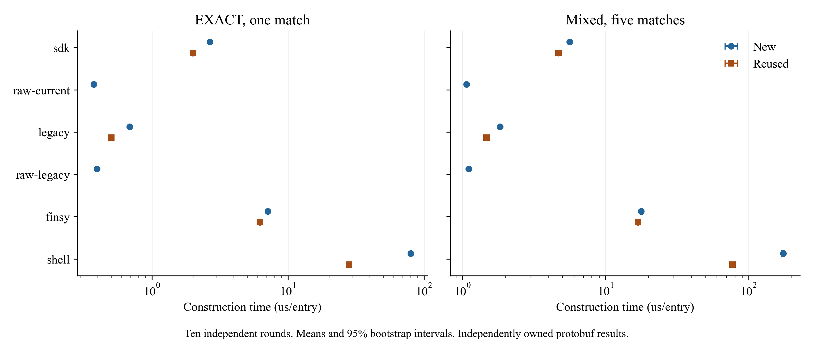

# Local table-entry construction

This dataset measures offline construction of a complete `TableEntry` protobuf. It has 270 measurements: twenty entry-construction conditions and seven SDK public-operation conditions, each repeated ten times. The six profiles and their pinned versions are the same as in the [RPC comparison](rpc-method.md#software-and-host).

## Recompute

Use Python 3.12 and the repository's pinned NumPy version:

```sh
python3 -m venv .venv
.venv/bin/python -m pip install -r requirements.txt
.venv/bin/python scripts/recompute_construction.py --output results/construction
```

The script verifies all 282 data and figure files, checks the execution order, reconstructs every measurement from its benchmark output and compares the results with the saved CSV. It then recomputes 65 metric summaries and 16 paired summaries, checking 567 numeric fields. The output directory contains regenerated summary CSV files and `verification.json`.

Reanalysis needs Python and NumPy. It uses the archived outputs and does not run a controller or switch.

To collect new measurements, use the [construction benchmark runners](running-construction.md). Setup installs the pinned clients and validates complete results and ownership before execution. The launcher supports a short run of all 27 conditions and the full ten-round comparison, with source snapshots and independent statistical checks.

## Workloads and timing

The [P4Info](../data/construction/fixtures/construct.p4info.txt) defines two tables and two actions. Each workload cycles through 256 [input samples](../data/construction/fixtures/inputs.json), including zero-valued OPTIONAL matches.

| Workload | Matches | Action parameters |
| --- | --- | --- |
| `exact` | 32-bit EXACT | 9-bit port |
| `mixed` | 32-bit EXACT, 32-bit LPM, 16-bit TERNARY, 16-bit RANGE, 8-bit OPTIONAL | 9-bit port and 32-bit tag |

SDK, legacy, Finsy and shell each have `new` and `reused` modes for both workloads. The raw Go protobuf profiles have `new` mode. Every timed construction returns a fresh, complete protobuf that can be retained independently. The legacy adapter copies borrowed input bytes, and the raw constructors also copy input bytes. Finsy and shell retain their native input representations and encoding paths.

Reuse retains each tool's construction objects. SDK retains its Builder, table definition and match map. Legacy retains its match map and match objects. Finsy retains its entry, match and action objects. Shell retains its entry, match key and action. Each invocation updates all input fields and returns a new protobuf.

P4Info initialization, input generation, representation conversion and creation of reused objects happen before timing. Go inputs use byte strings, Finsy inputs use integers and tuples, and shell inputs use pre-generated strings. Shell's parsing remains inside the timed construction. The timed scope covers entry construction. Wire serialization, WriteRequest preparation, SDK Write validation and cloning, RPC and target execution belong to the separate RPC workload.

Go uses `testing.B.Loop`, one-second benchtime, one P and `benchmem`. The saved `elapsed-ns` metric and iteration count determine `ns_per_op`. The displayed `ns/op` value is rounded. Python keeps GC enabled, calibrates for at least 0.2 seconds, collects once after calibration and then measures approximately one second.

Each repetition runs all 27 conditions in a shuffled order. Processes run sequentially, pinned to logical CPU 0. The host is the same WSL2 environment used for RPC measurements, with an 8 GiB memory limit and 2 GiB swap. The exported [environment](../data/construction/environment.json) records the CPU, kernel, affinity, observed memory totals, Go settings and Python package versions. The [plan](../data/construction/plan.json) and [run record](../data/construction/run.json) preserve the configuration and complete execution schedule.

The recorded preflight checked 5,120 constructed entries and result ownership, and passed Go race and vet checks. Its [summary](../data/construction/preflight.json) is part of the archive. Reanalysis checks that recorded summary and the benchmark outputs.

## Statistics

The sampling unit is an independent repetition. All ten completed rounds are retained. Means, medians, sample standard deviations, minima and maxima use the ten round values. The 95% mean interval is a percentile bootstrap with 20,000 resamples and seed 20261019. NumPy PCG64 generates one array of ten-index resamples, shared across conditions and metrics. Interval endpoints use linear interpolation at the 2.5th and 97.5th percentiles.

The reanalysis uses `math.fsum`, Python's `statistics` module and explicit sorted interpolation to check the saved summaries. NumPy supplies only the resampling indices.

Pairs compare SDK or legacy construction time with the corresponding raw Go profile, for both construction modes. Each tool also has a reused/new pair. A ratio is calculated inside each repetition before the ten ratios are summarized. There are eight pairs per workload. A ratio above one means that the numerator takes more time. The intervals have no multiplicity adjustment.

Seven additional conditions measure SDK table lookup, action lookup and protobuf cloning for both workloads, plus 32-bit byte encoding. These public operations are measured separately. Their timings are not an additive decomposition of complete construction.

## Figure



The horizontal axes use a logarithmic scale and show microseconds per entry. The figure retains all twenty complete-construction conditions. SDK reuse reduces construction time within the SDK, while the raw Go and legacy paths have lower measured local construction times in this workload.

Download the [PDF](../figures/construction/construction-time.pdf) or [PNG](../figures/construction/construction-time.png). Both use Times New Roman. The PDF embeds its font, and the PNG is 3060 by 1290 pixels at 300 dpi. Both files preserve the original figure bytes.

## Files and provenance

| File | Contents |
| --- | --- |
| [measurement-rounds.csv](../data/construction/measurement-rounds.csv) | 270 per-round measurements |
| [round-statistics.csv](../data/construction/round-statistics.csv) | 65 metric summaries |
| [paired-ratios.csv](../data/construction/paired-ratios.csv) | 16 paired construction-time summaries |
| [records.jsonl](../data/construction/records.jsonl) | Selected process outcomes and measured metrics |
| [stdout](../data/construction/stdout) | Output for each of the 270 measurements |
| [manifest.json](../data/construction/manifest.json) | File sizes, hashes, conditions, source commits and export transformations |

The three CSV files, input fixtures, 190 Go output files and both figures preserve the original bytes. The 80 Python output files omit the local interpreter's `executable` field. The selected process records omit `command` and `metrics.executable`, and add the observed stderr byte count. Every recorded exit code and stderr byte count is zero. All timing and allocation values are retained.

Run metadata selects the configuration and execution fields from the source manifest. Environment metadata selects platform, CPU, memory and package-version fields. The preflight summary omits its local source-file inventory. The catalog records the original source hashes and each transformation, including the hash of the complete original run manifest and the frozen benchmark source hashes.

Git preserves the archived file bytes across checkout. See the [column definitions](construction-data.md) and [licenses](../LICENSE.md). Experimental data, inventories and figures use CC BY 4.0. Code and documentation use Apache-2.0.
