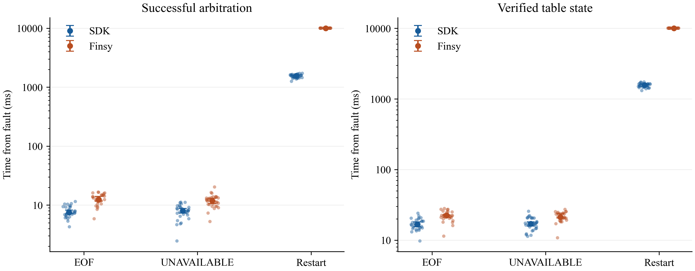
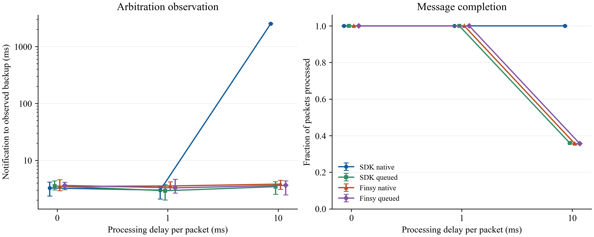

# Session recovery and stream behavior

The E3 archive compares SDK v2.0.1 and Finsy v0.30.0 in 840 trials recorded on 2026-10-19. Each of 28 configurations has 30 independent repetitions. Recovery and mastership use BMv2. Cancellation, close and slow-consumer scenarios use a controlled gRPC service.

## Verify the records

Use CPython 3.12 on Linux x86_64:

```sh
python3 -m venv .venv
.venv/bin/python -m pip install --require-hashes --only-binary=:all: --no-deps -r config/requirements-sessions.txt
.venv/bin/python -m pip check
.venv/bin/python scripts/verify_sessions.py --output results/sessions
.venv/bin/python -m unittest discover -s tests/sessions -v
```

Verification runs from archived records. It needs neither Go, p4c nor a running target. The output directory must be new. The verifier checks file inventories, compressed and uncompressed hashes, the randomized schedule, exact configuration coverage, event association and fixture correspondence. It runs the original evidence checks and an independent JSON/base64/integer decoder, checks actual Write events, reproduces trial outputs and all 62 statistical rows, and independently recomputes 496 summary values with NumPy.

The four original JSONL observation and event pairs preserve their complete bytes inside gzip streams with timestamp zero. All 840 driver stderr files are represented in per-group compressed collections. Thirty Finsy EOF tracebacks have their private source-directory prefix replaced with `<finsy-source>`. Original file hashes and exported text hashes are retained. Run metadata omits the local executable path and preserves its hash, execution-source inventory, settings and schedule.

## Plan and environment

| Group | Configurations | Repetitions per configuration | Trials |
| --- | ---: | ---: | ---: |
| Recovery | 6 | 30 | 180 |
| Mastership | 2 | 30 | 60 |
| Cancellation and close | 8 | 30 | 240 |
| Slow consumers | 12 | 30 | 360 |

Configurations are shuffled within each repetition using seed 20261019 plus the group's position in the plan. Groups run sequentially. The [plan](../data/sessions/plan.json) specifies all settings. The host is WSL2, Linux 6.6.87.2, x86_64, with an 8 GiB memory limit and 2 GiB swap. BMv2 is the 1.15.0-2bdd0b7b build used by the [RPC comparison](rpc-method.md).

The SDK commit is `3f2def2b28c098961078ce64e9d86ab3c79e6ccb`, and Finsy is `491a6e2ac67473ec2ee9a94601f6107ae5d76e7b`. Go drivers use Go 1.26.9. The Finsy environment uses Python 3.12.3, grpcio 1.81.1 and protobuf 6.33.6 with the upb backend. [environment.json](../data/sessions/environment.json) contains the recorded source inventory, memory state and Go build information.

The selected recovery and mastership groups come from the first formal run. During the first cancellation attempt, service cleanup released a final status that the timeout scenario was holding. The cancellation group was rerun from its first repetition after changing service cleanup, followed by the consumer group. The selected archive contains the complete rerun. The initial 38 completed cancellation trials and the failed trial are excluded. [selection.json](../data/sessions/selection.json) records the original group directories and selection reason. Smoke, race and earlier ten-repetition pilot runs are also outside this archive.

## Recovery

Each trial starts a new target and controller. The application writes port 1 with metadata `session-write` and verifies the entry through an independent connection. After 2.1 seconds of settling, the relay injects EOF or UNAVAILABLE, or restarts BMv2. Arbitration remains open throughout the trial. The observation window is 60 seconds.

The clients use their native session recovery and default retry policies. After successful arbitration, the common application checks whether the pipeline exists. It preserves the existing entry for stream faults. Following target restart, it installs the missing pipeline, verifies an empty table and inserts its recovery entry. Every recovered trial verifies port 2 and metadata `recovered`, together with the actual Write sequence.

All 180 trials recover, with no right-censored trials. Sixty restart trials require application pipeline restoration. Median times below are milliseconds from fault injection.

| Profile | Fault | Successful arbitration | Verified final state |
| --- | --- | ---: | ---: |
| SDK | EOF | 7.481 | 16.663 |
| SDK | UNAVAILABLE | 7.988 | 17.055 |
| SDK | Restart | 1,563.448 | 1,576.224 |
| Finsy | EOF | 12.444 | 22.327 |
| Finsy | UNAVAILABLE | 11.823 | 21.279 |
| Finsy | Restart | 10,035.575 | 10,050.143 |

Arbitration time ends when the relay receives the target's successful response. Final-state time also includes local polling, process communication, application restoration and Read. Restart times include target startup and the clients' default retry policies. The SDK reconnects the session; the application restores its configuration.



Points are independent trials. Solid markers and error bars show medians and 95% bootstrap intervals. Both vertical axes are logarithmic. Download [PDF](../figures/sessions/session-recovery.pdf) or [PNG](../figures/sessions/session-recovery.png).

## Mastership

Each controller begins with election ID 1 and writes an entry. A controller with ID 2 takes over. The application waits until the tested client observes backup state before attempting a MODIFY. In all 30 SDK trials, that call returns local `ErrNotPrimary` and emits no Write. In all 30 Finsy trials, it reaches the target and returns PERMISSION_DENIED.

After the higher-ID controller exits, all 60 trials restore primary state and successfully modify and read back the original entry. The records retain each library's election-ID behavior. The verifier compares the complete raw Write slices with copied outcomes and checks which writes occur during backup state.

## Cancellation and close

The service pauses reads to create backpressure. Queued and in-flight cancellation use 2 MiB requests. Immediate and graceful close use the same small request under paused reads. Every received request is checked by ID, size, SHA-256 and metadata.

| Profile | Scenario | Trials | Recorded result |
| --- | --- | ---: | --- |
| SDK | Cancel before call | 30 | Cancelled ID absent, later barrier received |
| SDK | Cancel while queued | 30 | Cancelled ID absent, later barrier received |
| SDK | Cancel in flight | 30 | Session recovers and barrier arrives |
| SDK | Immediate close | 30 | Send returns locally, service reads no request |
| SDK | Graceful close | 30 | Request and EOF arrive, close waits for final OK |
| SDK | Graceful timeout | 30 | Final status remains held, close returns DeadlineExceeded |
| Finsy | Cancel in flight | 30 | Session recovers and barrier arrives |
| Finsy | Immediate close | 30 | Send returns locally, service reads no request |

These records distinguish local send completion, service receipt and the stream's final status. The close experiments verify requests and stream completion. Packet forwarding is a separate workload.

## Slow consumers

Each trial emits 300 uniquely numbered 64-byte PacketIn messages at 500 messages per second, followed by a backup-state arbitration notification. Processing delays are 0, 1 and 10 milliseconds. The native SDK callback processes inline. The queued path uses an application queue of capacity 50 and drops new arrivals when full. Finsy retains its own capacity-50 PacketIn queue in both paths, with an additional application queue in the queued path.

All 240 trials with 0 or 1 millisecond processing delay process all 300 messages. At 10 milliseconds:

| Profile and path | Processed per trial, median [range] | Backup observation, median ms |
| --- | --- | ---: |
| SDK native | 300 [300, 300] | 2,513.842 |
| SDK queued | 108 [108, 109] | 3.451 |
| Finsy native | 107 [106, 107] | 3.828 |
| Finsy queued | 107 [106, 107] | 3.639 |

Across the 360 trials, 108,000 messages are emitted, 90,653 finish processing, 5,803 do not reach the application iterator, and 11,544 are dropped by the application queue. Unique IDs establish the accounting. RSS peaks are recomputed from every recorded sample.



The left axis is logarithmic and reports notification-to-observed-backup time. The right panel reports the fraction of messages processed. Markers and error bars show medians and 95% bootstrap intervals. Download [PDF](../figures/sessions/slow-consumer-tradeoff.pdf) or [PNG](../figures/sessions/slow-consumer-tradeoff.png). Both figures use Times New Roman, with embedded PDF fonts and 300 dpi PNGs.

## Statistics and files

The statistical unit is one independent trial. Each configuration contributes 30 trials. The 62 summaries cover four recovery intervals, mastership observation delay, consumer arbitration delay, processed count and peak sampled RSS. Quantiles use linear interpolation, type 7. Median confidence intervals use 10,000 bootstrap resamples, a percentile 95% interval and seed `20261019 + first four SHA-256 bytes of the configuration key`. [The data dictionary](session-data.md) defines the keys, fields and units.

| Material | Location |
| --- | --- |
| Selected runs, file hashes and original source hashes | [manifest.json](../data/sessions/manifest.json) |
| Fixed plan and selected run origins | [plan.json](../data/sessions/plan.json), [selection.json](../data/sessions/selection.json) |
| Original observations, events, stderr and target-process history | `data/sessions/<group>/` |
| Statistical summaries and configuration outcomes | [statistics.csv](../data/sessions/statistics.csv), [summary.json](../data/sessions/summary.json) |
| P4Info, P4 program and original test samples | [fixtures](../data/sessions/fixtures) |
| Verification entry point | [verify_sessions.py](../scripts/verify_sessions.py) |
| Original evidence checks and statistical calculations | [session_checks](../scripts/session_checks) |
| Original and exported analysis-source hashes | [session-source-provenance.json](../config/session-source-provenance.json) |

The four evidence functions, standard-library secondary checks, raw Write checks and statistical calculations retain their original bodies. Packaging adapts imports and fixture paths and omits private workspace snapshot copying. Thirteen original evidence-test methods are preserved. Added tests cover archive corruption, trial and event coverage, queue layers, randomized order and extra writes.

Verification reconstructs fixture-only snapshots in the output directory and checks them against the preserved execution inventories. The original execution-source and binary hashes remain in each `run.json`. The [live runner guide](running-sessions.md) provides pinned setup and smoke, race and full execution, with source snapshots and independent verification of new records.

Data and derived figures use CC BY 4.0. Analysis code and documentation use Apache-2.0. See [LICENSE.md](../LICENSE.md).
